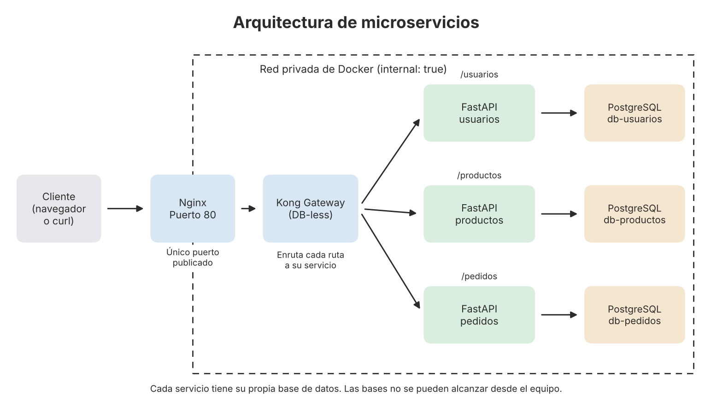

# Laboratorio: arquitectura de microservicios con Python y FastAPI

## 1. Qué es

Un sistema con tres servicios pequeños (usuarios, productos y pedidos). Cada uno tiene su propia base de datos PostgreSQL y todo se levanta con un solo comando.

## 2. Diagrama



El cliente entra por Nginx (el único puerto abierto, el 80), Nginx le pasa la petición a Kong y Kong la envía al servicio que corresponde. Cada servicio habla solo con su base de datos, dentro de una red privada.

## 3. Cómo ejecutarlo

Se necesita Docker Desktop. Desde esta carpeta:

```
docker compose up --build
```

Cuando termine de arrancar, en otra terminal:

```
curl.exe http://localhost/usuarios
curl.exe http://localhost/productos
curl.exe http://localhost/pedidos
```

Para apagarlo: `docker compose down`.

Los pasos completos para probarlo están en [como-probar.md](entregables/5-demostracion/como-probar.md).

## 4. Qué hace cada pieza

| Pieza | Para qué sirve |
|---|---|
| Nginx | Es la entrada del sistema. Es lo único que se puede alcanzar desde el equipo (puerto 80). |
| Kong | Recibe las peticiones de Nginx y las envía al servicio correcto según la ruta. |
| usuarios, productos, pedidos | Los tres servicios FastAPI. Cada uno responde su lista y tiene una ruta `/health` que comprueba que llega a su base de datos. |
| db-usuarios, db-productos, db-pedidos | Una base PostgreSQL para cada servicio. |
| Red privada | Red de Docker con `internal: true`. Las bases de datos no se pueden alcanzar desde el equipo. |

## 5. Pruebas y resultados

Los requisitos y cómo se midieron están en [requisitos.md](entregables/3-requisitos-calidad/requisitos.md).

| Aspecto | Resultado | Evidencia |
|---|---|---|
| Sistema funcionando | 8 contenedores corriendo; los 3 servicios y sus `/health` responden | [arquitectura](entregables/4-evidencias/arquitectura/) |
| Red privada | Red interna y puerto 5432 cerrado | [seguridad](entregables/4-evidencias/seguridad/) |
| Ruff (estilo del código) | 0 errores en los 3 servicios | [calidad](entregables/4-evidencias/calidad/) |
| pytest (pruebas) | 2 pruebas por servicio, cobertura de 100 % (se pedía 80 %) | [calidad](entregables/4-evidencias/calidad/) |
| Bandit (seguridad del código) | 0 hallazgos en los 3 servicios | [calidad](entregables/4-evidencias/calidad/) |
| Locust (rendimiento) | 100 usuarios, 2519 peticiones, 0 fallos, promedio de 5.19 ms (se pedía máximo 2 s) | [reporte completo](entregables/4-evidencias/calidad/locust.html) |

## 6. Problemas encontrados

1. **Kong no arrancaba.** El archivo `kong.yml` tenía por error el contenido del `docker-compose.yml`. Se corrigió el contenido.
2. **Error `No module named 'psycopg'`.** La dirección de la base de datos debía empezar con `postgresql+psycopg2://`. Con eso los servicios arrancaron bien.
3. **El puerto 5432 daba `True` en la prueba de seguridad.** No era el proyecto: un PostgreSQL instalado en Windows estaba usando ese puerto. Se detuvo ese servicio para hacer la prueba.
4. **El `&&` de la diapositiva no funciona en PowerShell 5.1.** Se usaron comandos separados.
